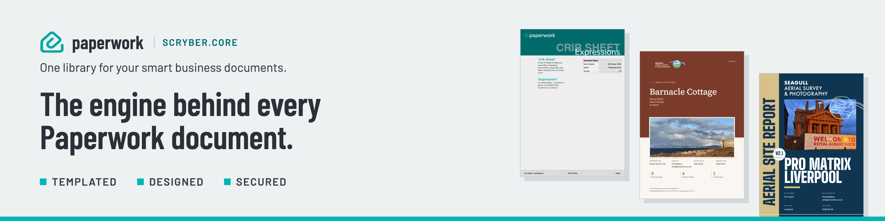

<p align="center">
  <a href="https://github.com/paperwork-collective/Paperwork.Core">Core</a> |
  <a href="https://github.com/paperwork-collective/Paperwork.CLI">CLI</a> |
  <a href="https://github.com/paperwork-collective/Paperwork.Skill">Skill</a> |
  <a href="https://paperwork.design" target="_blank" rel="noopener">Design</a> |
  <a href="https://paperwork.vu" target="_blank" rel="noopener">View</a> |
  <a href="https://paperwork.help" target="_blank" rel="noopener">Help</a> |
  <a href="https://www.paperwork-collective.com" target="_blank" rel="noopener">Corp</a>
</p>

# Scryber.Core

**The open-source rendering engine for Paperwork.Core.**

Scryber.Core is the open-source engine that turns HTML, CSS and SVG templates, bound to your data, into PDF documents, on .NET and in the browser with Blazor WASM. It is the rendering engine behind the open-source [Paperwork.Core](https://github.com/paperwork-collective/Paperwork.Core) library, which we recommend for generating documents. Paperwork.Core adds a fluent builder, dependency injection, code configuration and extensibility on top of this same engine, and your templates carry straight across (see [Switching to Paperwork.Core](#switching-to-paperworkcore)).

You are free to keep using Scryber.Core directly, as you always have, and it will continue to be maintained.

- Define templates with pages, content, shapes and images using HTML, CSS and SVG.
- Bring your data in from an API, an object model or JSON.
- Bind with handlebars syntax and full expression support.
- Lay out with styles, including calculated and relative values bound to your data.
- Output the document to a stream or file with a couple of lines of code.

In Blazor WASM, use the async save (`SaveAsPDFAsync`), as remote images, fonts and stylesheets load asynchronously. Encrypted and restricted documents work in the browser from 9.8.

## Getting Started

For generating documents in your applications, start with [Paperwork.Core](https://www.nuget.org/packages/Paperwork.Core/), which includes this engine:

```bash
dotnet add package Paperwork.Core
```

To use the engine directly, the Scryber.Core NuGet packages are here:

- [scryber.core](https://www.nuget.org/packages/scryber.core/): the base libraries for GUI or console applications.
- [scryber.core.mvc](https://www.nuget.org/packages/scryber.core.mvc/): for ASP.NET MVC (includes scryber.core).

The documentation covers the rest:

- [Getting started](https://paperwork.help/paperwork.core/quickstart/quickstart_core.html): a quick start that takes you through your first styled, bound template.
- [Learning guides](https://paperwork.help/paperwork.core/learning/): a full series on the main capabilities of the engine.
- [Reference guides](https://paperwork.help/paperwork.core/reference/): every supported element, style and binding expression.

---

## Templates, code and binding

The engine works from three parts: a template that defines the document, code that loads it and supplies data, and bindings that join the two.

### Template

Use standard (x)html content to define the template, with handlebar `{{ }}` notation for dynamic values.

```html
<html lang='en' xmlns='http://www.w3.org/1999/xhtml' >
<head>
    <!-- support for standard document attributes -->
    <meta charset='utf-8' name='author' content='{{meta.author}}' />
    <title>Hello World</title>
    <!-- add your styles -->
    <style> 
    </style>
    <!-- and reference remote style sheets -->
    <link href="/relative-stylesheet.css" rel="stylesheet" type="text/css" />
</head>
<body class="name" style="border: solid 1pt #AAA">
<!-- full binding support on content, styles and dynamic expressions -->
<h1 style="font-size: calc(theme.titleSize);">Hello {{name ?? 'World'}}</h1>
</body>
</html>

```
https://paperwork.help/paperwork.core/learning/01-getting-started/03_html_to_pdf.html

---

### Code: loading the template
The document is parsed into a complete object graph from local file paths, streams or dynamically created content.
```csharp
using Scryber.Components;
    
    using var doc1 = Document.ParseDocument("xhtml-template-path.html");
    using var doc2 = Document.ParseDocument(myContentStream);
    using var doc3 = Document.ParseHtmlDocument("non-formal-html-template-path.html");
    using var doc4 = Document.ParseDocument(new StringReader("<html xmlns='http://www.w3.org/1999/xhtml' >....</html>"))
```
https://paperwork.help/paperwork.core/learning/01-getting-started/02_first_document.html

---

### Code: adding data
Binding values are added using the documents' Params dictionary and can be set to any value, object graph, or json data.
```csharp
    //simple dynamic object
    doc.Params["meta"] = new { author = "My Name", reportDate = DateTime.Now };
    
    //structured object data
    doc.Params["model"] = GetMyModelData();
    
    //json data
    doc.Params["json"] = System.Text.Json.JsonSerializer.Deserialize(remoteAPIResult);
    
    //injected templated content
    doc.Params["templates"] = new 
    {
        innerContent = "<span class='header'>{{.title}}</span><br/><span class='desc'>{{.desc}}</span>"
    };
```

https://paperwork.help/paperwork.core/learning/02-data-binding/

---

### Code: outputting the result

The final output can be saved either to a file or stream, synchronously or asynchronously.

```csharp
//Simply save to a file
doc.SaveAsPDF("filePath.pdf");
            
//A standard IO stream
using var memory = new System.IO.MemoryStream();
doc.SaveAsPDF(memory);

//Or your own custom Stream
using var sourceStream = GetDataStream();
doc.SaveAsPDF(sourceStream);

//Also supports asynchronous operation
await doc.SaveAsPDFAsync("asyncfilepath.pdf");
   
```
https://paperwork.help/paperwork.core/learning/01-getting-started/07_output_options.html

Using the Scryber.Components.MVC package extensions

```csharp
public async Task<IActionResult> GetDocument()
{
    .
    .
    return await this.PDFAsync(doc)
}
```

---

## Other features

### Binding: loops, conditions and expressions
Handlebar support for dynamic content binding, and expressions
```html
<!-- looping support -->
<div id="contentWrapper" class="wrapper">
{{#each model.items}}
    <div>Item {{@index}}: {{.name}}
    <!-- conditional output and function support -->
    {{#if count(.nested)}}
        <!-- nested content and complex content creation with expressions -->
        <ul>{{#each .nested}}<li data-content="{{templates.innerContent}}"></li></ul>
    {{else}}<div class="muted">No inner items</div>
    {{/if}}
    </div>
{{/each}}
</div>
```

Add standard external templates using the embed element
```html
<div class="tsCs" >
    <embed src="./includes/termsAndConditions.html" />
</div>
```

Or create and inject components directly into the DOM
```csharp
var table = this.BuildTableGrid(loadedData);
var container = doc.FindAComponentById("contentWrapper") as Div;
container.Contents.Add(table);
```
---

### Page Sizes, headers and footers

The default page size is A4, but this can be changed to US specific letter or any standard size (or explicit).
Inner pages can also have their own sizing.

```html
<html lang='en' xmlns='http://www.w3.org/1999/xhtml' >
<head>
    <style> 
        
        @page{
            size: letter;
        }
        
        @page landscape{
            size: letter landscape;
        }
        
        .wide{
            page: landscape;
        }
        
    </style>
</head>
<body class="col2 landscape" style="border: solid 1pt #AAA">
    <h1>Main page in letter sizing</h1>
    <section class="wide">
        Content is by default on a new page with a 'section', and this will use the 'letter landscape' size based on the 'wide' class
    </section>
</body>
</html>
```

---

### Column layout.

The engine fully supports columnar layout both at the page level and also within blocks.

```html
<html lang='en' xmlns='http://www.w3.org/1999/xhtml' >
<head>
    <style> 
        @page landscape{
            size: A4 landscape;
        }
        
        @media print {
            /* force a landscape page with 2 column layout on the body *only* when printing */
            body {
                page: landscape;
            }
            
            .col2{
                column-count: 2;
                column-rule: 1pt solid silver;
            }
             
        }
    </style>
</head>
<body class="col2 landscape" style="border: solid 1pt #AAA">
    <h1>Main page flow in 2 columns</h1>
    <article class="col2">
        Content will flow in the inner columns, then onto the next side of the page
    </article>
</body>
</html>
```

Columns can also be used in footers, and a new column forced with break-before.

```html
<footer style="column-count: 3">
    <time datetime="{{meta.reportDate}}" data-format="dd MMM yyyy" />
    <page data-format="Page {0} of {1}" style="break-before: column; text-align: center" />
    <span style="break-before: column; text-align: right">{{meta.author}}</span>
</footer>
```
---

### Graphic Support
Images are supported for png, jpeg, tiff, gif, svg and webP (v9.5+)

```html


```
https://paperwork.help/paperwork.core/learning/06-content/01_images.html

Images can also be used as backgrounds and patterns
```css
.patterned{
    background-repeat: repeat-x;
    background-image: url("./localpath/diamond.png)";
}
```
https://paperwork.help/paperwork.core/reference/cssproperties/properties/css_prop_background-image.html

SVG's can be included inline within the document or using the embed element, that allows the content to use dynamic binding.
```html
<div class="logo" >
    <svg xmlns='http://www.w3.org/2000/svg' width='100%' height='100pt' preserveAspectRatio="xMidYMid">
        <rect x='10' y='10' width='{{length(meta.title) * 20}}' height='10' fill="#AAA" />
        <text fill="#AA0" text-anchor="middle">{{meta.title}}</text>
    </svg>
</div>
```
https://paperwork.help/paperwork.core/learning/06-content/02_svg_basics.html

---
### Font Support

The library includes the 14 standard PDF fonts (Courier, Helvetica and Times in four styles each, plus Symbol and ZapfDingbats). 
The system fonts, and custom fonts can be configured and loaded at initial execution time

https://paperwork.help/paperwork.core/configuration/font-configuration.html

Other fonts can also be defined through links or the @font-face rule

```html
<!-- link to google (watch the XML tag for a link) -->
<link href="https://fonts.googleapis.com/css2?family=Roboto:wght@400;700&amp;display=swap" rel="stylesheet"/>
<!-- or download and reference locally -->
<style>
    @font-face {
        font-family: 'Roboto';
        src: url('../fonts/Roboto-Regular.ttf') format('truetype');
        font-weight: 400;
        font-style: normal;
    }
    
    body{
        font-family: 'Roboto', sans-serif;
    }
</style>
```
https://paperwork.help/paperwork.core/learning/05-typography/03_web_fonts.html

---

### Modifying existing files

The engine supports modification of existing PDFs using framesets for page insertion, overlays, or contractions.

```html
<frameset xmlns='http://www.w3.org/1999/xhtml'>
    <!-- Add summary page before the referenced pdf -->
    <frame src="summary.html"></frame>
    <!-- Use only pages 1-3 from source PDF (0-indexed) -->
    <frame src="large-document.pdf" data-page-start="0" data-page-count="3">
        <!-- add an overlay to each page if we are outputting a proof document -->
        <h1 hidden="{{model.isProof ? '' : 'hidden'}}" 
            style="transform: rotate(45deg); opacity: 0.5; color: #444;">PROOF CONTENT</h1>
    </frame>
</frameset>
```
https://paperwork.help/paperwork.core/reference/htmltags/elements/html_frameset_frame_element.html

---

### Adding security
Restrict what a reader can do, and set the encryption, either through template meta tags or the document's RenderOptions.Permissions property. `print-restrictions` lists what is still **allowed**: once it is present, everything else is restricted (`all` restricts everything, `none` turns restrictions off).

```html
<head>
    <meta name="print-restrictions" content="printing, accessibility" />
    <meta name="print-encryption" content="128bit" />
</head>
```

```csharp
doc.RenderOptions.Permissions.AllowCopying = true;
doc.RenderOptions.Permissions.AllowPrinting = true;
doc.RenderOptions.Permissions.AllowAccessiblity = true;
```

When using restrictions it is advisable that an owner password be set on the document output (in lax mode, a random value will be assigned)

```csharp
using SecureString owner = CollectOwnerPassword();
doc.RenderOptions.PasswordProvider = new DocumentPasswordProvider(owner);
```
To force a password to be required to open a document, then set a user password (this can be the same as the owner password).

```csharp
using SecureString owner = CollectOwnerPassword();
using SecureString user = CollectUserPassword();

doc.RenderOptions.PasswordProvider = new DocumentPasswordProvider(owner, user);
```
https://paperwork.help/paperwork.core/learning/07-configuration/05_security.html

---

### Checking the output

To check the results, and what is happening underneath use the trace log support - either with the processing instructions at the very top of the template. 
This will add the processing log to the end of the resultant document, along with execution timing and any resources (fonts, images, etc) included.

```xml
<?paperwork append-log=true log-level=messages ?>
```
or use code on the document itself.

```csharp
doc.AppendTraceLog = true;
doc.TraceLog.SetRecordLevel(TraceRecordLevel.Verbose);
```

https://paperwork.help/paperwork.core/configuration/processing-instructions.html

---

## The engine also supports:

- standard [html body, tables, lists, divs and spans](https://paperwork.help/paperwork.core/reference/htmltags/) and many newer html5 [tags](https://paperwork.help/paperwork.core/reference/htmltags/)
- cascading styles: linked, embedded or inline using [css syntax and priority](https://paperwork.help/paperwork.core/learning/03-styling/).
- [attaching](https://paperwork.help/paperwork.core/reference/htmltags/elements/html_object_element.html) of external files or streams.
- [sizing](https://paperwork.help/paperwork.core/learning/03-styling/04_units_measurements.html) and [positioning](https://paperwork.help/paperwork.core/learning/04-layout/) of elements inline, block, relative or absolute.
- CSS flexbox (`display: flex`) and grid (`display: grid`) layout including named areas, auto-fill tracks, and alignment.
- table `colgroup`/`col` column definitions with widths, background colours, and span.
- support for [relative units](https://paperwork.help/paperwork.core/learning/03-styling/04_units_measurements.html) and [transformations](https://paperwork.help/paperwork.core/reference/cssproperties/properties/css_prop_transform.html).
- [gradients](https://paperwork.help/paperwork.core/reference/cssproperties/properties/css_prop_background-image.html) and colours with text and shape [fills, backgrounds](https://paperwork.help/paperwork.core/reference/cssproperties/) and borders.
- [multiple fonts](https://paperwork.help/paperwork.core/learning/05-typography/), including google fonts, supporting text [alignment; spacing; leading; decoration](https://paperwork.help/paperwork.core/learning/05-typography/05_text_spacing.html).
- Graphical binding support with SVG for [drawings and charts](https://paperwork.help/paperwork.core/learning/06-content/03_svg_drawing.html) and text.
- Full code support either as a whole document, or partial content, and [controllers](https://paperwork.help/paperwork.core/configuration/document-controllers.html).
- [Custom Component](https://paperwork.help/paperwork.core/configuration/custom-components.html) support for defining your own layouts or parts.

---

## Switching to Paperwork.Core

Paperwork.Core uses this engine, so the same HTML, CSS and SVG templates and the same binding expressions work unchanged. What changes is the code around them.

With Scryber.Core:

```csharp
using Scryber.Components;

using var doc = Document.ParseDocument("template.html");
doc.Params["model"] = GetMyModelData();
doc.SaveAsPDF("output.pdf");
```

With Paperwork.Core:

```csharp
using Paperwork;

using var factory = PaperworkFactory.Create().Build();

await factory.NewDocument()
    .WithLayoutFile("template.html")
    .WithData("model", GetMyModelData())
    .SaveAsync("output.pdf");
```

Things to know when you switch:

- **Async only.** Paperwork.Core has no `SaveAsPDF`. Use `SaveAsync` (to a path or a stream), `BuildBytesAsync`, or `BuildAsync` for a result that includes the log and any errors.
- **A `Document` you already build** can be passed in as it is, with `WithLayout(document)`. Its Params, RenderOptions (permissions, passwords, compression), Info and events are kept. Paperwork adds Creator and Producer when they are not set, its remote-file handling, and your `WithData` values.
- **Reserved names.** `$fields`, `$collection` and `$layouts` are set by Paperwork, so existing Params with those keys will clash.
- **Configuration carries across.** The `"Scryber"` appsettings section is still read, with `"Paperwork"` values overriding it, through `services.AddPaperwork(configuration)` or `PaperworkConfiguration.Init(configuration)`.
- **Scryber.Core.Mvc.** Paperwork has no `this.PDFAsync(doc)`. Return `File(await builder.BuildBytesAsync(), "application/pdf")`, or `await builder.SaveAsync(Response.Body)`. Scryber.Core.Mvc still works, but it bypasses Paperwork's auth, remote-file handling, logging and template security.
- **Remote access.** On its own, Paperwork.Core allows every host. [Paperwork.Core.Extensions](https://github.com/paperwork-collective/Paperwork.Core.Extensions) adds an allowed/blocked domain policy, which can refuse templates that load fonts, images or CSS from other sites.

See the [Paperwork.Core readme](https://github.com/paperwork-collective/Paperwork.Core) and [paperwork.help](https://paperwork.help) for the full builder.

---

## Getting Involved

We would love to hear your feedback. Feel free to get in touch.
Issues, ideas, includes are all welcome.

If you would like to help with building, extending then happy to get contributions

